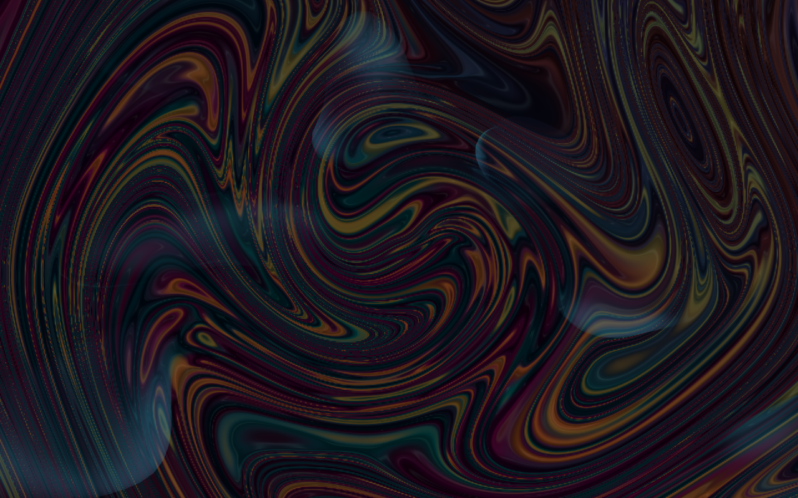

<h1 align="center">VR Fever Dream</h1>
<p align="center"><em>Living Feedback Garden — an endless, surreal drift through a fluid atmosphere.</em></p>

<p align="center">
  
</p>

<p align="center">
  
  
  
  
  
</p>

Drift through a space with no floor, no goal and no edge. Sparse, translucent cloud forms emerge out of an enclosing sphere of slowly mixing dye, retreat as you approach, and quietly change shape and colour. No combat, score, inventory or required destination — just the feeling of stepping inside an old music visualizer that has developed a memory.

> **Status:** working prototype (October 2026). Desktop is the default while the look and feel are tuned; OpenXR is opt-in. Real-headset performance, stereo and comfort checks are still pending.

## Features

- **Endless space** — no horizontal or vertical limit; forms recycle and coordinates rebase on long journeys.
- **Reactive clouds** — 16 deforming forms (10 at low density) that part around you, dissolve as you pass through, and slowly recover.
- **Marbled dream sphere** — a 14 m skin of petrol teal, bruised magenta and amber dye that warps as you move.
- **Three visual moods**, plus adjustable intensity, seated mode and cloud density.
- **Original synthesized ambient audio** — no asset downloads or plugins; everything is procedural meshes, shaders and generated sound.
- **Desktop and VR** — WASD/mouse drift on desktop; OpenXR controllers, teleport and snap turn in VR (no artificial continuous locomotion).
- **Headset-free test suite** — mocked tracking and ordinary `Camera3D` renders validate the XR code.

## Controls

| Desktop | Action |
| --- | --- |
| `WASD` / mouse | Drift / look |
| `Space` / `Ctrl` | Rise / sink |
| Left / right mouse | Disturb nearby forms |
| `Q` / `E` | Adjust reach |
| `Esc` | Settings (pauses the dream) |
| `M` · `R` · `F3` · `F11` | Mute · reset · diagnostics · fullscreen |

Press Enter or choose **Wander in** to begin. In VR: aim the right controller at the in-world settings and use the trigger; hold right trigger to aim at the floor and release to teleport; right stick gives 30° snap turns; left stick click toggles settings.

## Run it

Requires [Godot 4.7.2](https://godotengine.org/download) (stable). The launcher scripts expect it at `C:\Users\baxte\Downloads\Godot_v4.7.2-stable_win64.exe\` — edit the `$gardenEngine` / `$gardenConsole` path at the top of each `.ps1` to match your install.

### Desktop (default)

```powershell
.\Launch-Desktop.ps1
```

The launcher passes `--xr-mode off -- --desktop`, so no headset or runtime prompt appears. Alternatively open `project.godot` in Godot and press **Play (F5)**; Play launches desktop by default (`openxr/enabled=false`). If OpenXR is unavailable the scene falls back to the desktop preview.

To open the editor with XR kept off:

```powershell
.\Launch-Desktop.ps1 -Editor
# or, directly:
& 'path\to\Godot_v4.7.2-stable_win64.exe' --editor --xr-mode off --path .
```

Renderer: Compatibility on desktop; the VR launcher defaults to Mobile/Vulkan with a Compatibility option.

### Optional VR

VR is an explicit opt-in. [Launch-VR.ps1](Launch-VR.ps1) enables OpenXR (`--xr-mode on`) and may open your runtime/headset prompt:

```powershell
.\Launch-VR.ps1
# Optional OpenGL renderer for a runtime that supports it:
.\Launch-VR.ps1 -Renderer Compatibility
```

A Windows OpenXR runtime and controllers are needed for actual play. The scene selects an already initialized OpenXR interface once and falls back to desktop if it is unavailable.

In VR, settings include volume, intensity, seated stillness, density, resume, reset and exit. Tracked hands disturb nearby clouds without a button press. Loss of tracking or runtime focus pauses the dream and cancels queued movement; recenter preserves dream memory; reset uses a 3D fade visible to both eyes.

The Mobile/Vulkan default follows [Godot's XR renderer guidance](https://docs.godotengine.org/en/stable/tutorials/xr/setting_up_xr.html). Stereo rendering, bindings, reference-space behaviour and comfort still need a real headset check — see [VR integration validation](docs/validation/xr.md).

## Validation

```powershell
.\Validate-Desktop.ps1          # import and headless behavior fixtures
.\Validate-Desktop.ps1 -Render  # also checks visible input and saves screenshots
```

All validation processes explicitly disable XR. Screenshot/input checks use Dummy audio and short, automatically closing windows; an additional WASAPI startup check runs at exact zero gain. Tests cover desktop behaviour plus VR startup gates, lifecycle and transition math, controller rays and settings, and full integration with a normal `Camera3D`. Compatibility and Mobile/Vulkan mock scenes are rendered without XR output. See [desktop validation](docs/validation/desktop.md) and [VR validation](docs/validation/xr.md).

## Project layout

| Path | Contents |
| --- | --- |
| `scenes/`, `scripts/` | Main scene and typed GDScript (input, XR, dream director, visuals, audio, UI) |
| `shaders/` | Atmosphere, ground, ribbon and trace shaders |
| `resources/` | Mood and XR action-map resources |
| `tests/` | Headless and render validation scripts |
| `docs/` | Design, technical contracts, roadmap, agent handoff, validation reports and screenshots |

## Documentation

1. [Experience design](docs/DESIGN.md) — what to build and how it should feel.
2. [Technical contracts](docs/TECHNICAL.md) — Godot structure, shared interfaces and constraints.
3. [Roadmap and task packets](docs/ROADMAP.md) — dependency order, file ownership and acceptance checks.
4. [Agent handoff](docs/AGENT_HANDOFF.md) — reusable implementation prompt and reporting format.

## Notes for contributors

This project is developed with AI coding agents; see [AGENTS.md](AGENTS.md). Any automated Godot command must pass `--xr-mode off` (and `--desktop` after `--` for runnable scenes) so a headset runtime is never initialised during testing.

## Next work

Review the feel before expanding content. When convenient, select a headset/runtime for manual binding, tracking, stereo, performance and comfort checks. XR integration is implemented; hardware acceptance remains pending. No exported executable exists yet.

## License

[MIT](LICENSE)
